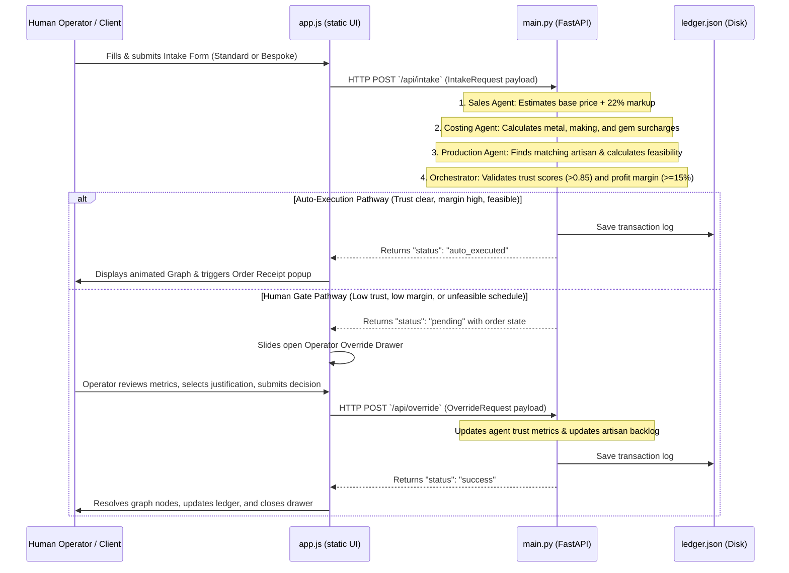
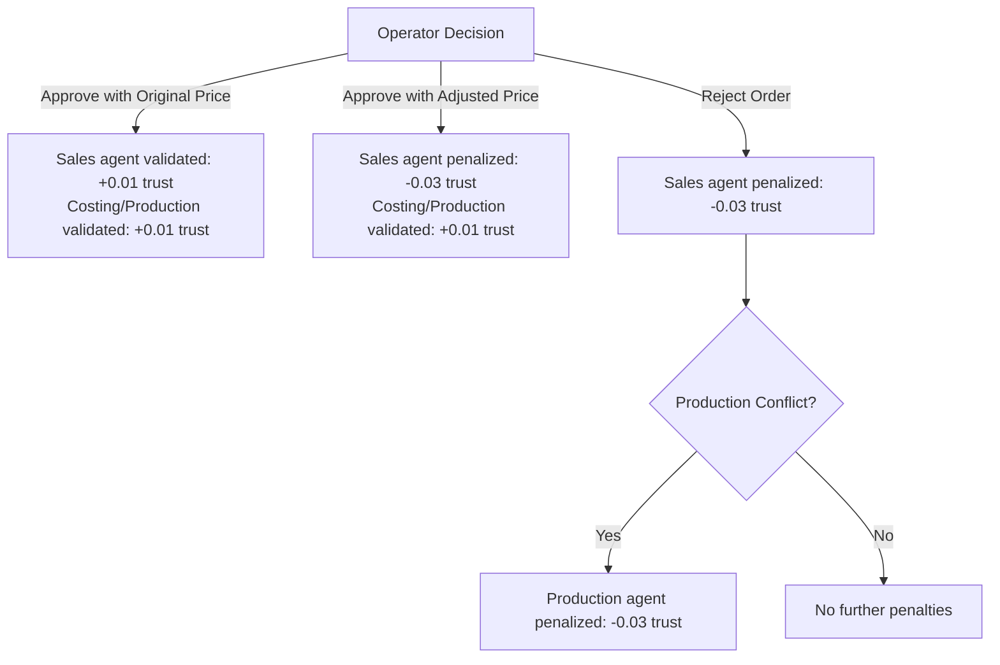

# Kasauti — Agentic Retail OS
## Technical Documentation & Architecture Reference

Welcome to the technical documentation of **Kasauti — Agentic Retail OS**. This document serves as a comprehensive guide for developers, maintainers, and architects. It provides a detailed breakdown of every file, function, layout component, API endpoint, client-side visualizer, and the underlying multi-agent collaboration model.

---

## 1. System Overview

**Kasauti** is a simulated luxury jewelry workshop orchestration platform built to demonstrate a **Human-in-the-Loop Multi-Agent Operating System**. It automates customer intakes, spot-rate costing validations, artisan capacity management, and fabrication schedule verification, while enforcing agent trust scores as safety gates.

### Core Philosophy
* **Multi-Agent Collaboration:** Different agent roles (Sales, Costing, Production) process orders sequentially, each validating constraints relevant to their domain.
* **Trust Score Safety Gate:** Each agent maintains a dynamic trust score (0.0 to 1.0) stored in-memory. If any agent's trust drops below the safety threshold (`0.85`), autonomous execution is locked, routing subsequent orders to a human operator for sign-off.
* **Manual Override & Adaptive Learning:** Human operators can approve, reject, or adjust pricing of locked orders. Adjustments feed back into the system, penalizing or rewarding agents to calibrate trust.
* **Atelier Craftsmanship Handoff:** Provides an exception channel to bypass standard digitization for bespoke heirloom designs, routing orders directly to the master artisan.

---

## 2. Project Architecture & File Connections

### File Structure Map
```text
kasouti__/
├── data/
│   └── ledger.json          # File database persisting resolved transactions
├── static/
│   ├── app.js               # Client-side state manager, visualizers & API handlers
│   ├── index.html           # Main dashboard UI structure
│   └── style.css            # Dark-mode theme configuration & layout styling
├── main.py                  # FastAPI server, business logic & background daemon
└── .gitignore               # Ignored build & cache directories
```

### Connection Architecture & Data Lifecycle
The following sequence details how data flows and components connect:



---

## 3. Backend Architecture: `main.py`

The backend is built with **FastAPI** and uses **Pydantic** models to validate requests. State is maintained in-memory and mirrored to a local JSON file database.

### 3.1 In-Memory State Configuration
The system state is seed-initialized as follows:
* **`spot`:** Live metal rates in USD per gram (`gold_usd_g`, `silver_usd_g`), currency multiplier (`usd_inr`), and feed status (`feed_online`).
* **`trust`:** Dynamic trust scores for `sales` (0.82), `costing` (0.90), and `production` (0.88).
* **`artisans`:** List of workshop craftsmen, their specialty matching a crafting technique, and their queue backlog in days.
* **`catalog`:** Standard design items available in the retail shop with set weight, technique, complexity, and sizes.
* **`ledger`:** Historically resolved orders, restored from `data/ledger.json` on startup.
* **`pending`:** The single active order currently locked in the human override gate (or `None`).
* **`audit_log`:** System operation logs containing timestamps, description text, and agent status category.

---

### 3.2 Core Math & Helper Functions

#### `calculate_purity_ratio(metal: str, karat_or_purity: str) -> float`
Calculates the purity multiplier for metal calculations.
* **Arguments:** 
  * `metal`: Gold or Silver.
  * `karat_or_purity`: String containing values like "18K", "22K", "92.5%", "sterling", "pure".
* **Logic:** Gold extracts numeric karats and divides by `24.0` (defaults to 22K -> `0.916`). Silver checks for "92.5" or "sterling" to return `0.925` (defaults to `1.0` for pure silver).

#### `get_making_charge(complexity: str) -> float`
Maps crafting complexity to making charges per gram in USD.
* **Complexity levels:** `low` = $5.00/g, `high` = $12.00/g, default (`medium`) = $8.00/g.

#### `get_base_fabrication_days(complexity: str) -> int`
Maps complexity to the base days required for manual metal smithing.
* **Tiers:** `low` = 2 days, `high` = 9 days, default (`medium`) = 5 days.

#### `get_matching_artisan(technique: str) -> Dict[str, Any]`
Finds a suitable artisan for an order.
* **Logic:** Iterates over the `artisans` list to find candidates matching the requested technique (filigree, stone-setting, polishing, engraving). If found, returns the matching artisan with the minimum backlog. If no candidate matches, falls back to the artisan with the least backlog overall.

#### `get_gemstone_surcharge(gemstone: Optional[str]) -> float`
Gets the pricing surcharge for preconfigured premium gemstones.
* **Values:** `Diamond` = $150.00, `Sapphire` = $110.00, `Emerald` = $90.00, `Ruby` = $80.00, `Pearl` = $40.00, others/none = $0.00.

#### `save_ledger()`
Saves the ledger state.
* **Logic:** Ensures the `data/` directory exists and dumps the `state["ledger"]` array to `data/ledger.json` with pretty indent spacing.

#### `log_audit(text: str, status: str = "SYSTEM")`
Appends a formatted log entry to `state["audit_log"]` using the current timestamp.

---

### 3.3 API Schema References (Pydantic Models)

* **`IntakeRequest`:**
  * `customer_name` (str)
  * `metal` (str) — Gold / Silver
  * `karat_or_purity` (str) — purity text
  * `weight_g` (float)
  * `budget` (Optional[float]) — Target price input
  * `deadline_days` (int) — Delivery constraint
  * `complexity` (str) — low/medium/high
  * `technique` (str) — filigree/stone-setting/polishing/engraving
  * `gemstone` (Optional[str])
  * `size` (Optional[str])
  * `finish` (Optional[str])
  * `photo_filename` (Optional[str])
  * `workshop_notes` (Optional[str])
  * `is_custom` (Optional[bool])

* **`OverrideRequest`:**
  * `decision` (str) — `"approve"` or `"reject"`
  * `adjusted_price` (Optional[float]) — Updated sales price set by operator
  * `memo` (Any) — Object with selected tags/memo text justifying the override

* **`ConfigRequest`:**
  * `feed_online` (Optional[bool])
  * `gold_usd_g` (Optional[float])
  * `silver_usd_g` (Optional[float])
  * `usd_inr` (Optional[float])

* **`HandoffRequest`:**
  * `customer_name` (str)
  * `notes` (str) — Crafting notes detailing physical shape mold complexities

* **`HandoffOutcomeRequest`:**
  * `handoff_id` (str)
  * `customer_name` (str)
  * `agreed_price` (float)
  * `notes` (str) — Resolution pathway details

---

### 3.4 REST API Endpoints

#### `GET /api/dashboard`
* **Response:** Returns the full `state` dictionary (spot rate, trust values, artisan list, design catalog, ledger, active pending gate details, audit stream).

#### `GET /api/external/spot-rates`
* **Response:** Subset of spot feed states, facilitating external system polling.

#### `POST /api/config`
* **Request:** `ConfigRequest`
* **Logic:** Allows manual overrides of rates or connection switches. Logs configuration changes in the system audit trail.

#### `POST /api/reset`
* **Logic:** Wipes local in-memory database and deletes the disk file `data/ledger.json`. Restores initial seeds.

#### `POST /api/intake`
* **Request:** `IntakeRequest`
* **Logic:** Runs sequential agent checks (described in section 5). 
* **Response Tiers:**
  * Auto-Executed: `{"status": "auto_executed", "order_id": order_id}`
  * Rerouted to Human Gate: `{"status": "pending", "order_id": order_id, "reason": reason_string}`

#### `POST /api/override`
* **Request:** `OverrideRequest`
* **Logic:** Processes operator override decisions. Updates metrics, updates artisan queue logs, saves records to the ledger, and sets `state["pending"] = None`.

#### `POST /api/upload`
* **Request:** Multipart form upload.
* **Logic:** Saves customer design reference photos to `static/uploads/`.
* **Response:** `{"status": "success", "filename": file.filename}`

#### `POST /api/handoff`
* **Request:** `HandoffRequest`
* **Logic:** Creates an exception entry in the ledger bypassing standard calculations. Awards compliance credit to the Sales Agent (`+0.01` trust score).

#### `POST /api/handoff-outcome`
* **Request:** `HandoffOutcomeRequest`
* **Logic:** Resolves the handoff ticket, adding the final customer charge to the transaction ledger.

---

### 3.5 Background Task: Jitter Loop
```python
async def jitter_rates_loop()
```
When `state["spot"]["feed_online"]` is `True`, this loop triggers every 10 minutes (`600` seconds). It applies a random jitter of `±1.5%` to gold and silver spot rates, simulating market volatility, and updates the system audit log.

---

## 4. Frontend Architecture: `static/`

The frontend is a single-page dashboard designed with semantic HTML5 elements and vanilla CSS. It uses responsive column grids and modern visual indicators.

### 4.1 UI Layout Structure (`index.html`)

```text
+-------------------------------------------------------------------------------+
| HEADER BAR (Brand Logo | Gold Spot Rate Ticker | Feed Config | System Reset)  |
+-------------------------------------------------------------------------------+
| DASHBOARD GRID (3-Column Layout)                                              |
|                                                                               |
| COLUMN 1 (450px)       | COLUMN 2 (Flexible Width)     | COLUMN 3 (340px)     |
| - Customer Intake Tabs  | - Master Agentic Visualizer   | - CAD Blueprint      |
|   (Standard / Bespoke  |   (Interactive SVG Node Graph)|   (Dynamic SVG Path) |
|    / Handoff panels)   | - Audit Log Terminal Stream   | - Artisan Queue list |
| - Catalog Templates    | - Master Ledger Table         | - Trust Safety Gauges|
+-------------------------------------------------------------------------------+
| MODALS & DRAWERS (Overlay Panels)                                             |
| - Market Feed Settings Modal                                                  |
| - Operator Override Gate (Slide-in Right Drawer Panel)                        |
| - Transaction Receipt / SOP Dispatch Overlay                                  |
+-------------------------------------------------------------------------------+
```

---

### 4.2 Styling & Animations (`style.css`)
* **Theme Variables:** CSS variables (`:root`) govern colors (deep charcoal `#060709` body background, dark gray `#0d0f13` panel background, luxury accent gold `#c5a880`), font sets (Outfit sans-serif, Playfair Display serif, Space Mono), and transitions.
* **Intake Panel:** Modeled as a **glassmorphic panel** with a translucent blur (`backdrop-filter`) and thin gold borders.
* **Trust Gauges:** Uses SVG circular track overlays with dynamic offsets configured via Javascript stroke-dasharrays.
* **Audit Terminal:** Stylized to look like a terminal shell. Specific classes color code outputs: `.log-txt-error` (red), `.log-txt-warning` (orange), `.log-txt-success` (green), and `.log-txt-info` (blue).
* **Animations:**
  * `pulse-glow-gold`: Pulses gold box-shadow offsets to draw attention to live systems.
  * Node highlights (`processing` triggers pulsing golden loops, `blocked` indicators glow red).

---

### 4.3 Client-Side Logic (`app.js`)

`app.js` handles client-side state, form interactions, SVG drawing, local currency conversions, and polling interfaces.

#### Key Functions

#### `setupSpeechRecognition()`
Initializes standard browser speech-to-text interfaces. When the microphone button is toggled inside the custom notes text area, it toggles browser recording, turning verbal notes into text draft notes on the fly.

#### `drawCADBlueprint()`
Draws live vector shapes on the blueprint canvas based on the intake specifications.
* **Rings:** Draws concentric circles with diameter lines (showing `Ø 18.5mm`). If the gemstone is not `"None"` or the weight is heavy, it draws diamond facets at the top with mounting prongs.
* **Necklace Sets:** Draws a curved neckline string along with a drop-pendant silhouette decorated with internal scrolls.
* **Bangle/Kada:** Draws overlapping ellipses.

#### `runGraphAnimation(outcome, callback)`
Animates the node graph.
* **Process:** Uses a timed step machine. As an order progresses from intake to sales, costing, and production nodes, it changes SVG classes (`graph-node processing` or `graph-node success`).
* **Branching:** If costing resolves to pending (due to trust lock or rate exceptions), it highlights the override node as `blocked` (red) and stops the flow, opening the drawer. If successful, it animates through all nodes, concluding with a pulsing ledger path.

#### `toggleApprovalDrawer(pending)`
Controls the slide-in override drawer.
* **Process:** If the backend registers a pending order, it displays the drawer, populates customer specifications, and checks safety lock causes.
* **Metrics Parsing:** Parses the production status notes (backlogs, allocated artisans, timeline constraints) and configures status badges.
* **Pricing Comparison:** Compares the operator's adjusted price input with the suggested price, changing input colors between red (shortfall margin) and green (margin cleared).

#### `handleStdSubmit` / `handleCustSubmit`
Assembles form payloads (templates, selected purities, adjust weights, budgets, finishes) and executes POST requests to `/api/intake`. Disables UI buttons to prevent double submissions.

#### `updateSpotTicker()`
Converts spot rates based on the global `currentCurrency` (`USD` or `INR`). It updates prices in the header bar and dynamically updates the ledger table and receipts.

---

## 5. Core Agentic Workflows & Life Cycles

Kasauti operates as a sequential chain of autonomous specialized agents governed by an orchestration logic block.

```text
+-----------------------+
|  Customer Intake      |  -> Intake payload received
+-----------+-----------+
            |
            v
+-----------------------+
|  Sales Agent          |  -> Evaluates budget. If missing, applies +22% markup on estimated cost
+-----------+-----------+
            |
            v
+-----------------------+
|  Costing Agent        |  -> Checks if live spot rate feed is online
|                       |  -> Calculates true cost: (spot rate * weight * purity) + fabrication surcharge + gemstone surcharge + $45 base premium
+-----------+-----------+
            |
            v
+-----------------------+
|  Production Agent     |  -> Assigns artisan based on specialty (e.g. Shankar Das for filigree)
|                       |  -> Estimates total timeline: artisan backlog + fabrication days + 2-day QC buffer
+-----------+-----------+
            |
            v
+-----------------------+
|  Orchestrator Gate    |  -> Checks logic conditions (Trust scores, net margins, feasibility)
+-----------+-----------+
            |
            +------ (Trust Scores >= 0.85 AND Margin >= 15% AND Timeline feasible) -------> [AUTO-EXECUTION]
            |
            +------ (Trust Scores < 0.85 OR Margin < 15% OR Timeline unfeasible) --------> [HUMAN OVERRIDE DRAWER]
```

### 5.1 Orchestration Gating Matrix

When an intake reaches the orchestrator, it evaluates branching conditions:

| Pathway | Triggering Conditions | Outcome | Trust Updates |
| :--- | :--- | :--- | :--- |
| **Auto-Executed** | Net margin $\ge 15\%$, all agent trust scores $\ge 0.85$, and delivery is feasible. | Bypasses operator reviews, saves directly to the ledger, and allocates backlog days to the selected artisan. | **Reward:** Sales $+0.01$, Cost $+0.01$, Prod $+0.01$ |
| **Safety Lock Gate** | Net margin $\ge 15\%$ but one or more agent trust scores is below threshold ($< 0.85$). | Suspends transaction. Routes order details to the Operator Override Drawer. | **Depends on Operator Action:** See section 5.2 |
| **Production Conflict Gate** | Delivery timeline is unfeasible (artisan backlog + crafting days exceeds deadline). | Suspends transaction. Routes order details to the Operator Override Drawer with a production conflict tag. | **Depends on Operator Action:** See section 5.2 |
| **Margin Deficit Gate** | Net profit margin falls below $15\%$. If margin is between $10\%$ and $15\%$, it triggers a standard safety block. If margin is below $10\%$, it triggers a critical override block. | Suspends transaction. Routes order details to the Operator Override Drawer with a deficit warning. | **Depends on Operator Action:** See section 5.2 |

---

### 5.2 Trust Score Calibration Math

When a human operator makes a decision inside the override gate, it validates the agent predictions:



---

## 6. Developer How-To Guides

### 6.1 Running the Project Locally
The project has no external dependencies besides `FastAPI`, `Uvicorn`, `Pydantic`, and standard python libraries.

1. **Install python requirements:**
   ```bash
   pip install fastapi uvicorn pydantic
   ```
2. **Launch the web application:**
   Make sure you are in the workspace folder:
   ```bash
   python main.py
   ```
3. **Open browser window:**
   Navigate to [http://127.0.0.1:8000/](http://127.0.0.1:8000/)

---

### 6.2 Adding a New Design Template
To add a new standard design option to the catalog:

1. **Register the design backend seed** in [main.py](file:///e:/kasouti__/main.py#L33-L37) (inside `state["catalog"]`):
   ```python
   {
       "name": "Traditional Gold Pendant",
       "weight_g": 8.0,
       "complexity": "low",
       "technique": "engraving",
       "gemstone": "None",
       "size": "Standard",
       "finish": "High Polish"
   }
   ```
2. **Define default dimensions and properties** in [static/app.js](file:///e:/kasouti__/static/app.js#L27-L39):
   Add mapping arrays to `templateSizes` and defaults to `templateDefaults`:
   ```javascript
   // under templateSizes
   "Traditional Gold Pendant": ["Standard"]
   
   // under templateDefaults
   "Traditional Gold Pendant": {
       metal: "Gold",
       purity: "22K",
       weight: 8.0,
       gem: "None",
       size: "Standard",
       technique: "engraving",
       complexity: "low"
   }
   ```
3. **Add template cards structure** to [static/index.html](file:///e:/kasouti__/static/index.html#L93-L100):
   ```html
   <button type="button" class="template-card-btn" data-template="Traditional Gold Pendant">
       <span class="template-card-name">Gold Pendant</span>
       <span class="template-card-desc">8.0g · Gold · Engraving</span>
   </button>
   ```

---

### 6.3 Adjusting Trust Safety Gate Thresholds
Safety gates and thresholds can be configured directly in [main.py](file:///e:/kasouti__/main.py):

* **Trust safety limit:** Look for the trust score check `t_sales >= 0.85` inside the `/api/intake` endpoint ([main.py:L354](file:///e:/kasouti__/main.py#L354)) and adjust `0.85` to a higher or lower value as needed.
* **Auto-execution profit margin:** Edit `net_margin >= 0.15` ([main.py:L348](file:///e:/kasouti__/main.py#L348)) to require higher or lower profit margins for automated orders.
