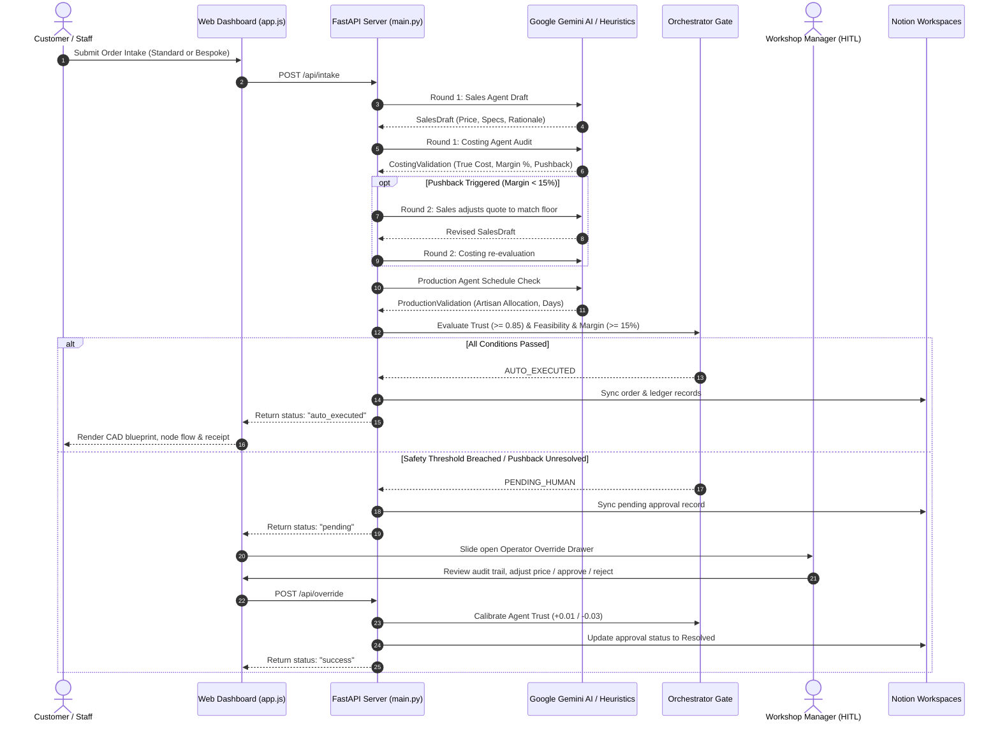

# Kasouti (कसौटी) — Agentic Retail OS

> **A Human-in-the-Loop Multi-Agent Operating System for Bespoke Luxury Jewelry Ateliers.**


---

## 🌟 Overview

In traditional Indian jewelry making, **Kasouti (कसौटी)** is the black touchstone used by master goldsmiths to assay the purity of gold against standard alloys.

**Kasouti — Agentic Retail OS** modernizes this concept into an autonomous workshop orchestration platform. It models a **collaborative multi-agent system** where specialized AI agents (Sales, Costing, Production) negotiate pricing, material costs, and workshop scheduling in real time, guarded by dynamic **Trust Score safety gates** and a **Human-in-the-Loop (HITL) operator drawer**.

```
                           ┌──────────────────────────┐
                           │      Customer Intake     │
                           └─────────────┬────────────┘
                                         ▼
                           ┌──────────────────────────┐
                           │       Sales Agent        │
                           └─────────────┬────────────┘
                                         ▼
                           ┌──────────────────────────┐
                           │      Costing Agent       │
                           └─────────────┬────────────┘
                                         ▼
                           ┌──────────────────────────┐
                           │     Production Agent     │
                           └─────────────┬────────────┘
                                         ▼
                           ┌──────────────────────────┐
                           │    Orchestrator Gate     │
                           └───────┬───────────┬──────┘
                                   │           │
     Trust >= 0.85 & Margin >= 15% │           │ Trust < 0.85 OR Margin < 15%
                                   ▼           ▼
                         [Auto-Execution]   [Human Override Drawer]
```

---

## 💎 Key Features

- 🤝 **Multi-Agent Bounded Negotiation Loop**
  - **Sales Agent:** Analyzes customer requests, protects budgets or suggests premium pricing, recommends finishes, and formulates design rationale.
  - **Costing Agent:** Computes true cost using live metal spot rates, purity ratios (18K, 22K, 92.5% Sterling), making charge tiers (low/med/high), and gemstone surcharges. Enforces a strict $\ge 15\%$ profit margin.
  - **Production Agent:** Matches required crafting techniques (filigree, stone-setting, polishing, engraving) to the least backlogged artisan, factoring in fabrication time and a 2-day QC buffer.
  - **Bounded 2-Round Consensus:** Agents automatically negotiate pushbacks across up to two rounds before routing to the human gate if consensus is not reached.

- 🛡️ **Dynamic Trust Calibration & Safety Gates**
  - Each agent maintains a dynamic trust score ($0.0$ to $1.0$).
  - If any agent's trust drops below the safety threshold (`0.85`), the order is locked from autonomous execution and routed to the human operator.
  - Human validation provides feedback: approving an order rewards agents ($+0.01$), while manual price corrections or rejections penalize trust ($-0.03$).

- 🔄 **Resilient Dual-Engine AI Architecture**
  - **LLM Pipeline:** Powered by Google Gemini with a cascade fallback chain (`gemini-3.5-flash` $\rightarrow$ `gemini-3.5-pro` $\rightarrow$ `gemini-2.5-flash` $\rightarrow$ `gemini-2.5-pro` $\rightarrow$ `gemini-1.5-flash` $\rightarrow$ `gemini-1.5-pro`) and Pydantic structured output validation.
  - **Deterministic Rule Fallback:** Seamless zero-crash fallback to exact mathematical pricing and heuristics if external API keys or networks are offline.

- 📐 **Dynamic Parametric CAD Blueprint Visualizer**
  - Client-side SVG blueprint rendering engine.
  - Draws live technical schematics for rings (with faceted gems, prongs, and diameter markings), bridal necklaces (contour drape, pendant motifs), and kadas/bangles based on form inputs.

- 📊 **Interactive SVG Agentic Flow Graph**
  - Real-time animated node visualizer displaying order progression across intake, agent validation stages, and ledger resolution.

- 🗄️ **Bidirectional Notion Workspace Sync**
  - Synchronizes agent turn logs, sales proposals, costing audits, production schedules, and the master transaction ledger directly with Notion databases.
  - Includes a background polling daemon (10s cadence) for cross-platform status updates.

- 🎙️ **Voice-to-Text Workshop Notes**
  - Integrated Web Speech API microphone dictation for fast intake notes at the jeweler's counter.

- 🏛️ **Atelier Craftsmanship Handoff**
  - Dedicated exception channel for bespoke heirloom items and physical mold casts that bypass automated intake directly to master craftsmen.

- 📈 **Live Spot Rate Market Ticker**
  - Live gold and silver rates with USD/INR conversion.
  - Background jitter simulation daemon executing $\pm 1.5\%$ market volatility every 10 minutes.

---

## 🏛️ System Architecture



---

## 📁 Repository Structure

```text
kasouti__/
├── static/
│   ├── app.js               # Client state, SVG CAD generator, node graph, speech recognition
│   ├── index.html           # Dark luxury UI dashboard, CAD previewer, override drawer
│   ├── style.css            # Luxury dark aesthetic, glassmorphism, gold accents, animations
│   └── uploads/             # Storage for custom uploaded design references
├── data/
│   └── ledger.json          # Persistent backup ledger of resolved transactions
├── DOCUMENTATION.md         # In-depth architectural & developer reference manual
├── main.py                  # Core FastAPI application, agent orchestrator & state daemon
├── notion_sync.py           # Multi-database Notion API integration & background poller
├── test_agents.py           # Comprehensive unit tests for agents, schemas & fallbacks
├── .env                     # API keys and Notion database IDs (git-ignored)
└── README.md                # Project README & quick-start guide
```

---

## 🚀 Quick Start Guide

### 1. Prerequisites
- Python **3.10** or higher
- Modern web browser (Chrome, Edge, Firefox, Brave)
- Optional: Google Gemini API key and Notion integration tokens

### 2. Installation

Clone the repository and install dependencies:

```bash
git clone https://github.com/arnav-verma200/kasouti__.git
cd kasouti__

# Install required packages
pip install fastapi uvicorn pydantic httpx python-dotenv google-genai
```

### 3. Environment Configuration

Create a `.env` file in the project root:

```env
# Google Gemini API Key (optional - system falls back to rule-based engine if omitted)
GEMINI_API_KEY="your-gemini-api-key"

# Notion Multi-Database Integration (optional - system logs locally if omitted)
SALES_NOTION_TOKEN="ntn_your_sales_token"
SALES_DATABASE_ID="your_sales_database_id"

COSTING_NOTION_TOKEN="ntn_your_costing_token"
COSTING_DATABASE_ID="your_costing_database_id"

PRODUCTION_NOTION_TOKEN="ntn_your_production_token"
PRODUCTION_DATABASE_ID="your_production_database_id"

ORCHESTRATOR_NOTION_TOKEN="ntn_your_orchestrator_token"
ORCHESTRATOR_DATABASE_ID="your_orchestrator_database_id"
```

> **Note:** If `.env` is omitted or credentials are blank, Kasouti automatically boots in **offline fallback mode** with mathematical rule engines and local auditing.

### 4. Running the Application

Start the FastAPI application:

```bash
python main.py
```

Or using Uvicorn directly:

```bash
uvicorn main:app --reload --host 127.0.0.1 --port 8000
```

Open your browser and navigate to:
```
http://127.0.0.1:8000
```

---

## 🧪 Testing

Run the automated test suite covering Pydantic models, agent fallbacks, bounded negotiation caps, and trust calibration:

```bash
python -m unittest test_agents.py
```

Test categories included:
- `test_pydantic_schema_validation`: Validates Sales, Costing, Production, and Negotiation turn models.
- `test_startup_fallback`: Tests full order completion via deterministic rules when Gemini is unavailable.
- `test_per_call_fallback`: Simulates an LLM failure mid-negotiation and ensures graceful degradation.
- `test_negotiation_cap_hit`: Tests the 2-round negotiation limit triggering human oversight.
- `test_trust_calibration_math`: Validates trust reward ($+0.01$) and penalty ($-0.03$) formulas.

---

## 📡 REST API Reference

| Method | Endpoint | Description |
| :--- | :--- | :--- |
| `GET` | `/api/dashboard` | Returns full system state (spot rates, trust scores, artisans, catalog, pending gate, audit stream). |
| `GET` | `/api/external/spot-rates` | Lightweight endpoint for spot rates and market feed status. |
| `POST` | `/api/intake` | Submits standard or custom intake; executes multi-agent negotiation. Returns `auto_executed` or `pending`. |
| `POST` | `/api/override` | Submits Human Operator approval/rejection and price adjustment for a gated order. |
| `POST` | `/api/config` | Updates spot rates (gold/silver), USD/INR multiplier, or toggles the market feed online/offline. |
| `POST` | `/api/reset` | Resets all in-memory structures and trust scores to factory seeds. |
| `POST` | `/api/upload` | Uploads reference sketch/photo for bespoke orders. |
| `POST` | `/api/handoff` | Routes a custom physical mold piece directly to master artisans. |
| `POST` | `/api/handoff-outcome` | Resolves an atelier handoff with final pricing. |

---

## ⚖️ Trust Calibration Matrix

When an order reaches the **Human Operator Override Gate**, decisions calibrate future agent autonomy:

| Action | Sales Trust | Costing Trust | Production Trust | Backlog Update |
| :--- | :---: | :---: | :---: | :--- |
| **Approve (Original Quote)** | $+0.01$ | $+0.01$ | $+0.01$ | Assigned artisan backlog increased |
| **Approve (Adjusted Price)** | $-0.03$ | $+0.01$ | $+0.01$ | Assigned artisan backlog increased |
| **Reject (General)** | $-0.03$ | $0.00$ | $0.00$ | Backlog unchanged |
| **Reject (Production Conflict)** | $-0.03$ | $0.00$ | $-0.03$ | Backlog unchanged |
| **Atelier Handoff Initiated** | $+0.01$ | $0.00$ | $0.00$ | Sent directly to Master Craftsman |

---

## 🛠️ Tech Stack

- **Backend:** FastAPI, Python 3.10+, Uvicorn, Pydantic v2
- **AI / LLM:** Google Gemini API (`google-genai` SDK) with multi-model fallback cascade
- **Database & Sync:** Notion API (v2022-06-28), HTTPX Async Client, JSON Ledger
- **Frontend:** Vanilla JavaScript (ES6+), Semantic HTML5, CSS3 Glassmorphism
- **Graphics & CAD:** Dynamic SVG Path Generation, Web Speech API

---

## 📄 License

This project is open-source under the [MIT License](LICENSE).
